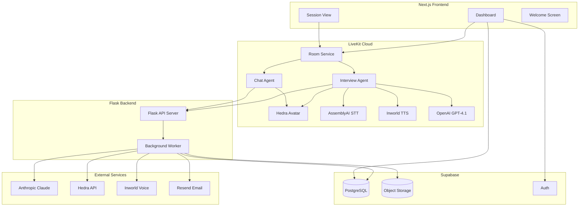
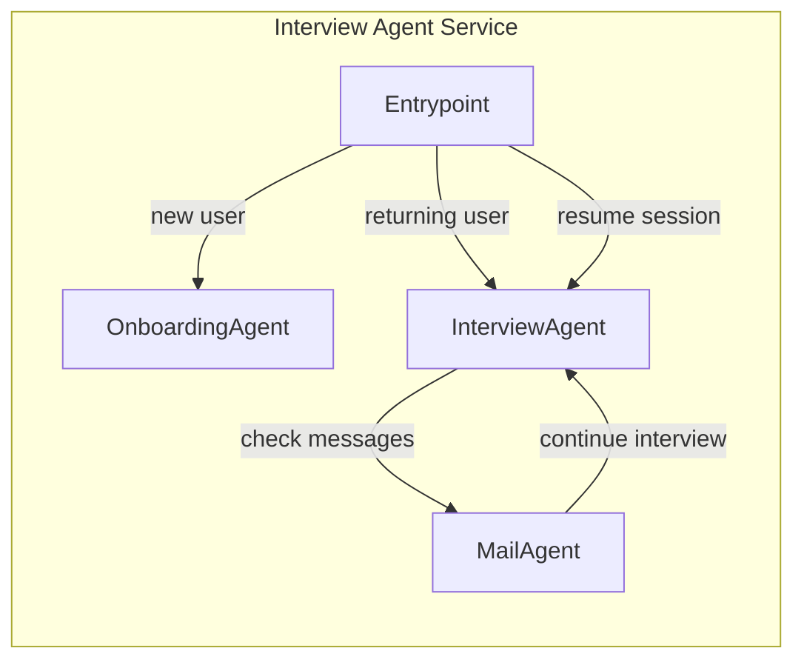
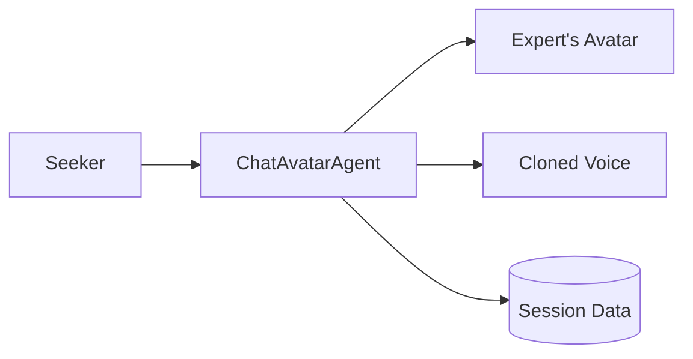
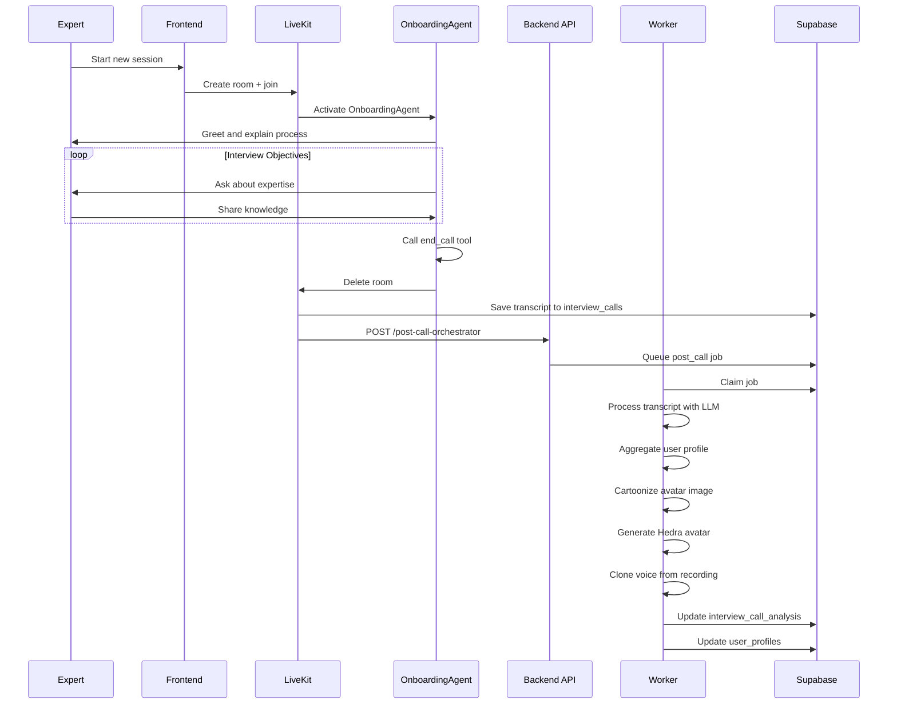
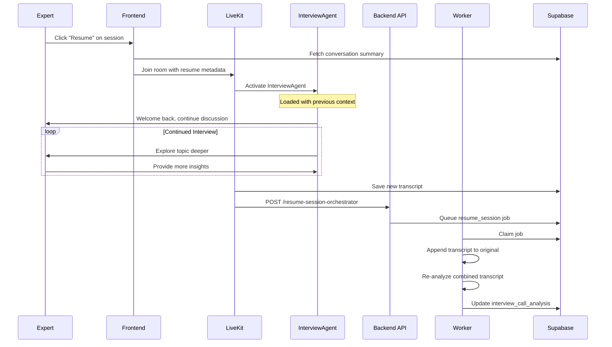
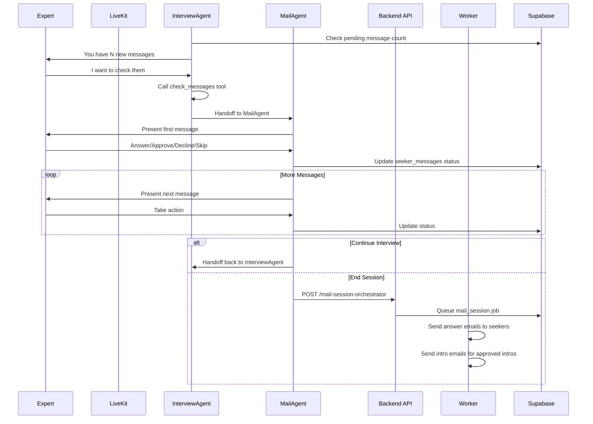
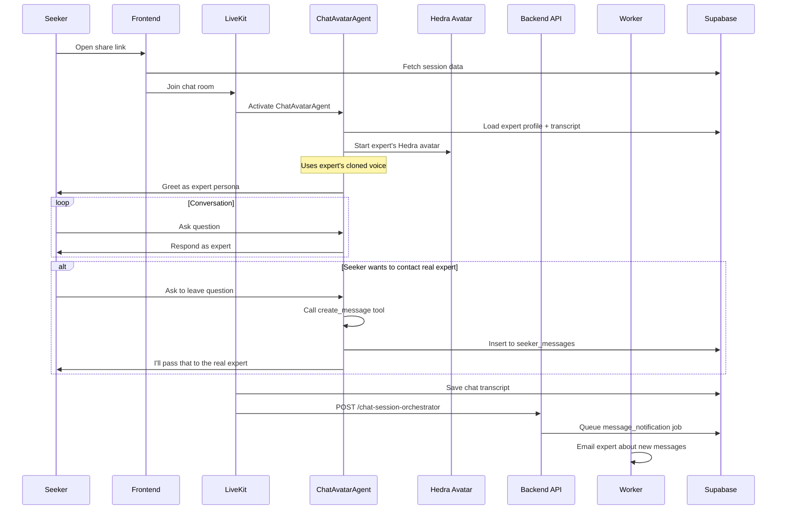
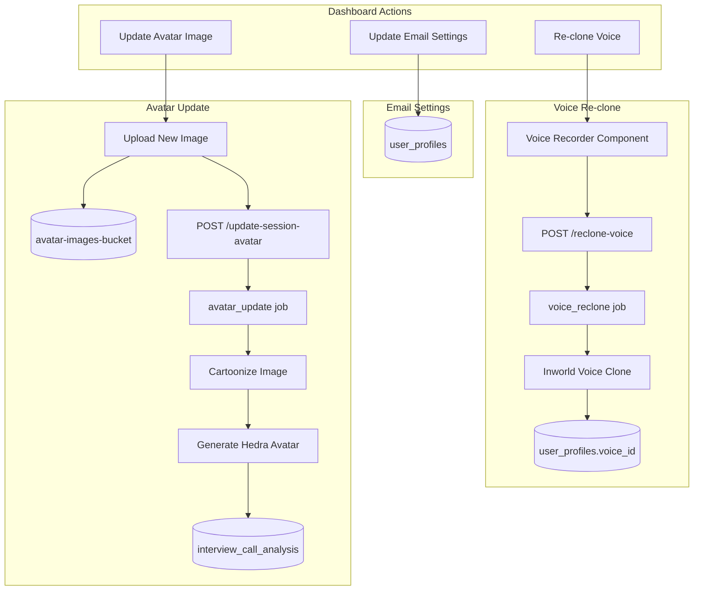
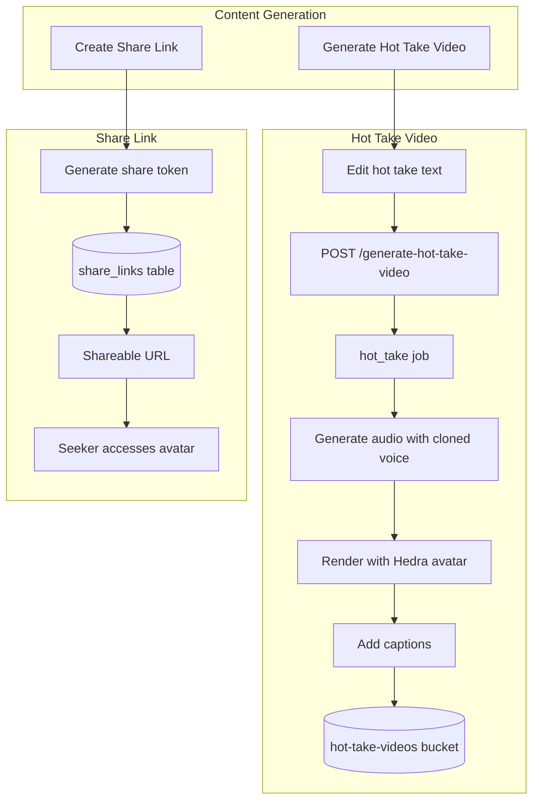
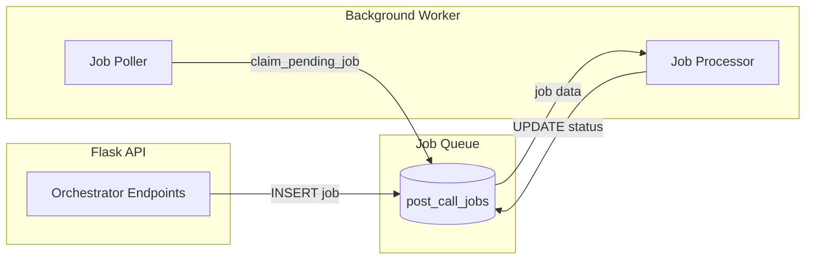

# Expert Avatar Interview Agent

A voice AI platform that enables experts to create interactive AI avatars of themselves. Experts conduct voice interviews to capture their knowledge, which is then transformed into a shareable avatar that seekers can chat with to learn from their expertise.

## Overview

Expert Avatar consists of three main components:

- **Next.js Frontend** - Dashboard for managing sessions, viewing avatars, and initiating calls
- **Flask Backend** - API and background worker for processing calls and generating avatars
- **LiveKit Agents** - Real-time voice AI agents that conduct interviews and power avatar chats

## System Architecture



## Agent Architecture

The interview agent uses a multi-agent handoff pattern to handle different conversation phases efficiently. This minimizes latency by keeping each agent's context focused.



| Agent | Purpose |
|-------|---------|
| **OnboardingAgent** | Conducts initial interview with new experts to capture their expertise, background, and unique perspectives |
| **InterviewAgent** | Handles returning users for deeper interviews, with personalized prompts based on their profile |
| **MailAgent** | Presents pending messages from seekers and handles responses (answer questions, approve/decline intros) |

### Chat Agent (Separate Service)

The `expertavatar-chat-agent` is a separate LiveKit agent that powers seeker-facing avatar sessions. It loads the expert's profile, transcript, and cloned voice to create an interactive avatar experience.



## User Flows

### Flow 1: New Expert Onboarding

A new expert creates their first avatar session through an onboarding interview.



**Backend Processing Tasks:**
1. **Transcript Processing** - Extracts main topic, hot takes, key insights using Claude
2. **Profile Aggregation** - Builds comprehensive user profile from all sessions
3. **Image Cartoonization** - Transforms photo to editorial illustration style
4. **Hedra Avatar Generation** - Creates animated video avatar from cartoon
5. **Voice Cloning** - Clones expert's voice from call recording

### Flow 2: Expert Resume Session (Update Content)

An expert returns to add more content to an existing avatar session.



### Flow 3: Expert Reviews Messages (MailAgent Handoff)

An expert checks and responds to messages from seekers who chatted with their avatar.



### Flow 4: Seeker Chats with Expert Avatar

A seeker interacts with an expert's shareable avatar to learn from their expertise.



### Flow 5: Dashboard Settings

Users manage their account settings from the dashboard.



### Flow 6: Video Generation and Sharing

Experts generate shareable videos and avatar session links from the dashboard.



## Backend Job Queue

The backend uses a Supabase-based job queue with a polling worker for async processing.



**Job Types:**

| Job Type | Description |
|----------|-------------|
| `post_call` | Full post-call processing (transcript, profile, avatar, voice) |
| `resume_session` | Append new conversation to existing session |
| `mail_session` | Process answered questions and approved intros |
| `message_notification` | Notify experts about new seeker messages |
| `hot_take` | Generate hot take video with avatar |
| `avatar_update` | Re-cartoonize and regenerate Hedra avatar |
| `voice_reclone` | Clone voice from new audio recording |

## Key Services

| Service | Location | Purpose |
|---------|----------|---------|
| `TranscriptProcessor` | `expert-avatar-backend/services/` | LLM analysis of call transcripts |
| `ProfileAggregator` | `expert-avatar-backend/services/` | Builds comprehensive user profiles |
| `VoiceCloningService` | `expert-avatar-backend/services/` | Clones voices via Inworld/Cartesia |
| `HedraAvatarGenerator` | `expert-avatar-backend/services/` | Creates video avatars via Hedra API |
| `CartoonGenerator` | `expert-avatar-backend/services/` | Transforms photos to illustrations |
| `EmailService` | `expert-avatar-backend/services/` | Sends notification emails via Resend |
| `MessageOrchestrator` | `expert-avatar-backend/services/` | Routes Q&A and intro requests |

## Development Setup

### Prerequisites

- Python 3.11+
- [uv](https://github.com/astral-sh/uv) package manager
- LiveKit Cloud account
- Supabase project

### Environment Variables

Create a `.env.local` file with:

```bash
# LiveKit
LIVEKIT_API_KEY=
LIVEKIT_API_SECRET=
LIVEKIT_URL=

# Supabase
SUPABASE_URL=
SUPABASE_SERVICE_KEY=
SUPABASE_S3_ACCESS_KEY_ID=
SUPABASE_S3_SECRET_ACCESS_KEY=

# AI Services
ANTHROPIC_API_KEY=
OPENAI_API_KEY=

# Avatar & Voice
HEDRA_API_KEY=
INWORLD_API_KEY=
INWORLD_WORKSPACE_ID=

# Backend
BACKEND_URL=http://localhost:5001
BACKEND_API_KEY=
```

### Running Locally

```bash
# Install dependencies
uv sync

# Run the interview agent
uv run python agent.py dev

# In another terminal, run the backend
cd ../expert-avatar-backend
uv run python app.py

# Run the worker
uv run python worker.py
```

### Running Tests

```bash
uv run pytest
```

## Project Structure

```
expertavatar-interview-agent/
├── agent.py                 # Main agent entrypoint
├── prompts/
│   ├── interview_prompt.txt # Interview agent instructions
│   ├── mail_prompt.txt      # Mail agent instructions
│   └── onboarding_prompt.txt # Onboarding agent instructions
├── services/
│   ├── gender_detection.py  # Name-based gender detection for avatar selection
│   ├── message_data.py      # Seeker message data access
│   └── user_data.py         # User profile data access
└── utils.py                 # Prompt loading utilities
```

## Related Projects

- `expertavatar-interview-frontend/` - Next.js dashboard and session UI
- `expertavatar-chat-agent/` - Seeker-facing avatar chat agent
- `expert-avatar-backend/` - Flask API and background worker
